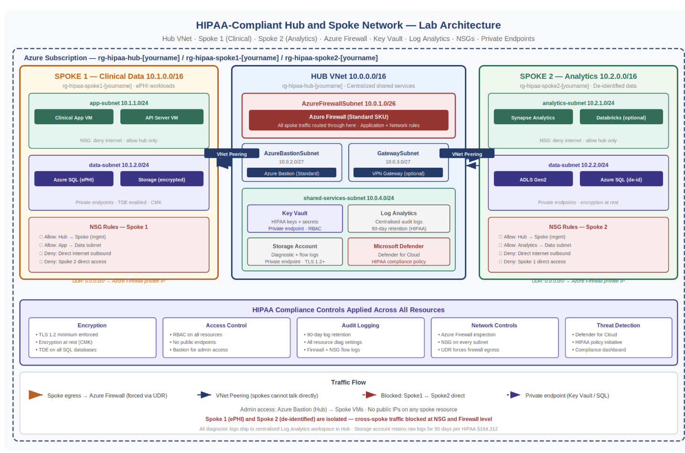
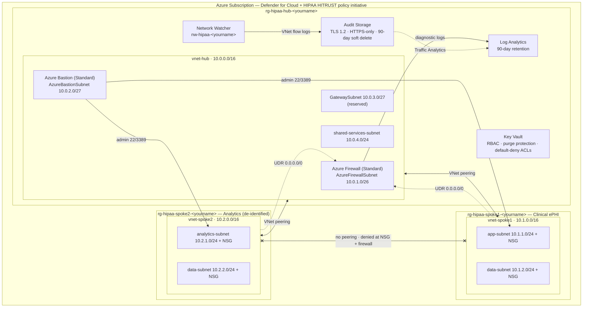

# 🏥 HIPAA-Compliant Hub-and-Spoke Network on Azure

**Status:** ✅ Complete — deployed with Terraform, validated, and documented

Terraform-deployed, HIPAA-aligned hub-and-spoke network on Azure: Azure Firewall with forced egress, NSG + firewall segmentation between a clinical (ePHI) spoke and an analytics (de-identified) spoke, Azure Bastion, Key Vault, centralized Log Analytics, VNet flow logs with Traffic Analytics, and the HIPAA HITRUST policy initiative via Microsoft Defender for Cloud.

## 🎬 Video Walkthrough

> 🎥 **Loom walkthrough:** [Watch the full build (≈4.5 min)](https://loom.com/share/416e368e1228430cadbf35f7cfdb9682)

## 📖 Project Overview

Healthcare organizations that store or process electronic Protected Health Information (ePHI) have to meet the technical safeguards in HIPAA §164.312: access control, audit controls, integrity, and transmission security. Building those controls separately into every workload doesn't scale and drifts over time. A hub-and-spoke topology solves that by putting the security services in one place (the hub) and letting every workload network (a spoke) inherit them.

This project builds that network foundation end-to-end in Terraform:

- **Hub VNet** with Azure Firewall, Azure Bastion, a reserved GatewaySubnet, a centralized Log Analytics workspace, Key Vault, and an audit-log storage account.
- **Spoke 1 — Clinical (raw ePHI)** and **Spoke 2 — Analytics (de-identified data)**, each in its own VNet and resource group, peered to the hub and **never** to each other.
- **Forced egress:** user-defined routes send `0.0.0.0/0` from every spoke subnet to the firewall's private IP, so nothing leaves a spoke uninspected.
- **Two independent layers of spoke isolation:** NSG deny rules on each spoke subnet **and** named deny rules in the Azure Firewall policy.
- **Audit trail:** firewall diagnostic logs to Log Analytics, plus VNet flow logs on both spokes with 90-day retention and Traffic Analytics.
- **Continuous compliance:** Microsoft Defender for Cloud (Servers, Storage, Key Vault) and the built-in HIPAA HITRUST Azure Policy initiative assigned at subscription scope.

### HIPAA §164.312 mapping — what this code deploys

| Safeguard | Controls deployed |
|---|---|
| Access Control — §164.312(a)(1) | Azure RBAC on Key Vault (Key Vault Administrator role assignment); Azure Bastion for admin access; no public IPs on spoke resources |
| Audit Controls — §164.312(b) | Central Log Analytics workspace (90-day retention); firewall diagnostic logs (application, network, DNS proxy + metrics); VNet flow logs on both spokes |
| Integrity — §164.312(c)(1) | Key Vault soft delete (90 days) + purge protection; 90-day blob soft delete on the audit storage account |
| Transmission Security — §164.312(e)(1) | TLS 1.2 minimum + HTTPS-only on storage; Key Vault network ACLs default to **Deny** |
| Network Segmentation | Hub-and-spoke topology, NSG on every spoke subnet, UDR-forced firewall inspection, no spoke-to-spoke peering |
| Threat Detection | Defender for Cloud (Servers, Storage, Key Vault) + HIPAA HITRUST policy initiative |

> **Scope note:** The architecture diagram below shows the full target design, including workloads (VMs, Azure SQL, Synapse, ADLS), private endpoints, and customer-managed keys. This Terraform deploys the **network and governance foundation** those workloads land on. A production HIPAA environment also needs BAAs, written policies, and administrative/physical safeguards that sit outside infrastructure code.

### Skills Demonstrated

- Hub-and-spoke network design with non-transitive VNet peering and forced tunneling via UDRs
- Azure Firewall with Firewall Policy (application and network rule collections)
- Defense in depth — NSGs and the firewall enforce the same spoke isolation independently
- Centralized audit logging: Log Analytics, diagnostic settings, VNet flow logs, Traffic Analytics
- Key Vault hardening: RBAC authorization, soft delete, purge protection, default-deny network ACLs
- Subscription-scope governance: Defender for Cloud plans and a regulatory policy initiative
- Mapping regulatory requirements (HIPAA §164.312) to concrete Azure controls
- Terraform (azurerm 4.x): multi-resource-group deployments, variables/outputs, gitignored secrets

## 🏗️ Architecture Diagram



**Deployed topology (as built by `main.tf`):**



## ✅ Prerequisites

| Requirement | How to verify (PowerShell) |
|---|---|
| Azure CLI installed and signed in | `az account show` |
| Terraform v1.5+ | `terraform -version` |
| Active Azure subscription | `az account list --output table` |
| Owner, or Contributor + User Access Administrator, on the subscription (Defender plans, the policy assignment, and the Key Vault role assignment need it) | `az role assignment list --assignee $(az account show --query user.name -o tsv) --output table` |

> 💰 **Cost warning:** Azure Firewall Standard is the main cost driver (roughly $1.25/hour), with Bastion Standard on top. Destroy the environment when you're not actively using it — the whole stack redeploys with `terraform apply`.

## 📁 Repository Structure

```
.
├── main.tf                    # All resources: hub, spokes, firewall, Bastion, logging, peering, Defender, policy, flow logs
├── variables.tf               # Name suffix, region, tags, address spaces, subscription ID
├── outputs.tf                 # VNet IDs, firewall IPs, Bastion, Key Vault URI, workspace ID, RG names
├── terraform.tfvars.example   # Copy to terraform.tfvars (gitignored) and fill in
├── docs/
│   └── architecture-diagram.png
└── .gitignore                 # Excludes tfvars, state, .terraform/, plan files
```

## 🏷️ Naming Conventions

All names use a `<yourname>` suffix from `terraform.tfvars`.

| Resource | Name |
|---|---|
| Resource groups | `rg-hipaa-hub-<yourname>`, `rg-hipaa-spoke1-<yourname>`, `rg-hipaa-spoke2-<yourname>` |
| VNets | `vnet-hub-<yourname>`, `vnet-spoke1-<yourname>`, `vnet-spoke2-<yourname>` |
| Azure Firewall / Public IP | `fw-hipaa-<yourname>` / `pip-firewall-<yourname>` |
| Firewall Policy / Rule Collection Group | `fwpol-hipaa-<yourname>` / `rcg-hipaa` |
| Azure Bastion / Public IP | `bastion-hipaa-<yourname>` / `pip-bastion-<yourname>` |
| Key Vault | `kv-hipaa-<yourname>` |
| Log Analytics Workspace | `law-hipaa-<yourname>` |
| Audit Storage Account | `sthipaaaudit<yourname>` |
| NSGs | `nsg-spoke1-app-`, `nsg-spoke1-data-`, `nsg-spoke2-app-`, `nsg-spoke2-data-<yourname>` |
| Route Tables | `rt-spoke1-<yourname>`, `rt-spoke2-<yourname>` |
| Network Watcher | `nw-hipaa-<yourname>` |
| VNet Flow Logs | `flowlog-spoke1-<yourname>`, `flowlog-spoke2-<yourname>` |
| Policy Assignment | `hipaa-hitech` (HIPAA HITRUST initiative) |

> Keep `<yourname>` short and lowercase-alphanumeric: `kv-hipaa-<yourname>` must fit Key Vault's 24-character limit and `sthipaaaudit<yourname>` must fit storage's 24-character, lowercase-only limit.

## 🔐 Security Design

### Azure Firewall policy (`rcg-hipaa`)

| Collection | Priority | Action | Rules |
|---|---|---|---|
| `allow-azure-services` (application) | 100 | Allow | HTTPS 443 from both spokes to Azure Monitor (`*.ods/oms.opinsights.azure.com`, `*.monitoring.azure.com`) and Windows Update |
| `deny-spoke-to-spoke` (network) | 200 | Deny | `deny-spoke1-to-spoke2` (10.1.0.0/16 → 10.2.0.0/16), `deny-spoke2-to-spoke1` (reverse) |

The policy is attached directly to the firewall with `firewall_policy_id`, so the named rules are actually enforced and show up by name in the logs.

### NSG rules

| NSG | Rule | Priority | Effect |
|---|---|---|---|
| `nsg-spoke1-app` / `nsg-spoke2-app` | `allow-hub-inbound` | 100 | Allow TCP 22/3389 from hub (Bastion) |
| | `deny-spoke2-inbound` / `deny-spoke1-inbound` | 3000 | Deny all traffic from the other spoke |
| | `deny-internet-inbound` | 4000 | Deny all inbound from Internet |
| `nsg-spoke1-data` / `nsg-spoke2-data` | `allow-spoke*-app-inbound` | 100 | Allow TCP 1433/443 from the same spoke's app subnet only |
| | `deny-all-other-inbound` | 4096 | Deny everything else |

### Routing

Each spoke has a route table (`rt-spoke1`, `rt-spoke2`) associated with **both** of its subnets. One route — `force-internet-via-firewall` — sends `0.0.0.0/0` to the firewall's private IP as a Virtual Appliance next hop, with BGP route propagation disabled.

## 🪜 Deployment Steps

### Step 1 — Clone and configure

```powershell
git clone https://github.com/salmanshah4/HIPAA-Compliant-Hub-and-Spoke-Network.git
```

```powershell
cd HIPAA-Compliant-Hub-and-Spoke-Network
```

```powershell
Copy-Item terraform.tfvars.example terraform.tfvars
```

Edit `terraform.tfvars`:

```hcl
yourname        = "<your-lowercase-name>"
location        = "eastus2"
subscription_id = "<your-subscription-id>"   # az account show --query id -o tsv
```

`terraform.tfvars` is gitignored, so the subscription ID never lands in the repo.

### Step 2 — Deploy

Run each line separately:

```powershell
az login
```

```powershell
terraform init
```

```powershell
terraform plan "-out=main.tfplan"
```

```powershell
terraform apply main.tfplan
```

Applying a saved plan guarantees that what was reviewed is exactly what gets built. Quote the `-out=` argument in PowerShell, otherwise it splits on the period.

### Step 3 — Validate network isolation

**Firewall private IP** (the next hop both route tables should point to):

```powershell
terraform output firewall_private_ip
```

**Spoke route table sends `0.0.0.0/0` to the firewall:**

```powershell
az network route-table show --name rt-spoke1-<yourname> --resource-group rg-hipaa-spoke1-<yourname> --query "routes[].{Name:name, Prefix:addressPrefix, NextHop:nextHopIpAddress}" --output table
```

**Both hub peerings are Connected:**

```powershell
az network vnet peering list --resource-group rg-hipaa-hub-<yourname> --vnet-name vnet-hub-<yourname> --query "[].{Name:name, State:peeringState}" --output table
```

**NSG rules block internet and cross-spoke inbound:**

```powershell
az network nsg show --name nsg-spoke1-app-<yourname> --resource-group rg-hipaa-spoke1-<yourname> --query "securityRules[].{Name:name, Priority:priority, Access:access, Source:sourceAddressPrefix}" --output table
```

Expected: `deny-spoke2-inbound` at 3000 and `deny-internet-inbound` at 4000, both `Deny`.

**Firewall policy is attached to the firewall:**

```powershell
az network firewall show --name fw-hipaa-<yourname> --resource-group rg-hipaa-hub-<yourname> --query "firewallPolicy.id" --output tsv
```

**Key Vault public access defaults to Deny:**

```powershell
az keyvault show --name kv-hipaa-<yourname> --query "properties.networkAcls.defaultAction" --output tsv
```

**VNet flow logs are enabled:**

```powershell
az network watcher flow-log list --location eastus2 --query "[].{Name:name, Enabled:enabled, RetentionDays:retentionPolicy.days}" --output table
```

### Step 4 — Query firewall logs in Log Analytics

Portal → `law-hipaa-<yourname>` → **Logs**:

```kusto
AzureDiagnostics
| where ResourceType == "AZUREFIREWALLS"
| where TimeGenerated > ago(1h)
| project TimeGenerated, Category, msg_s = column_ifexists("msg_s", "")
| order by TimeGenerated desc
| take 50
```

`column_ifexists` keeps the query from failing before the first firewall rule log arrives. To confirm the diagnostic pipeline is live even with no spoke traffic yet, check firewall metrics:

```kusto
AzureMetrics
| where ResourceProvider == "MICROSOFT.NETWORK"
| where TimeGenerated > ago(1h)
| take 20
```

## 🎞️ Build Walkthrough (Loom timestamps)

**1. Define the HIPAA security requirements the network must satisfy** — [0:00](https://loom.com/share/416e368e1228430cadbf35f7cfdb9682?t=0)


Encryption in transit and at rest, audit controls and access logging, automatic logoff, integrity controls, and transmission security were treated as mandatory design constraints for every resource and network path.

**2. Design the hub-and-spoke architecture around compliance controls** — [0:43](https://loom.com/share/416e368e1228430cadbf35f7cfdb9682?t=43)


Shared security and management services live in the hub; spokes isolate workloads by data sensitivity; all inter-spoke traffic is forced through the hub for inspection and logging.

**3. Build the hub network and shared security services** — [0:43](https://loom.com/share/416e368e1228430cadbf35f7cfdb9682?t=43)


Azure Firewall, Azure Bastion, Log Analytics, and Key Vault deployed into the hub as the central enforcement point.

**4. Create Spoke 1 for clinical workloads (raw ePHI)** — [1:02](https://loom.com/share/416e368e1228430cadbf35f7cfdb9682?t=62)


Dedicated VNet for ePHI workloads, no direct internet access, outbound only through the firewall.

**5. Create Spoke 2 for analytics (de-identified data)** — [1:12](https://loom.com/share/416e368e1228430cadbf35f7cfdb9682?t=72)


Separate VNet and resource group, logically and administratively separated from the clinical environment.

**6. Force all spoke-to-spoke traffic through the firewall** — [1:27](https://loom.com/share/416e368e1228430cadbf35f7cfdb9682?t=87)


UDRs make the firewall the only path out of a spoke, supporting auditability, segmentation, and threat detection.

**7. Implement access control and administrative safeguards** — [1:36](https://loom.com/share/416e368e1228430cadbf35f7cfdb9682?t=96)


Entra ID RBAC, unique user identification, Bastion instead of public management endpoints, and Key Vault for secrets.

**8. Enforce encryption, logging, and endpoint restrictions** — [2:20](https://loom.com/share/416e368e1228430cadbf35f7cfdb9682?t=140)


Centralized Log Analytics, soft delete on Key Vault and storage, TLS 1.2 minimum, and default-deny public access.

**9. Enable threat detection and HIPAA policy monitoring** — [2:58](https://loom.com/share/416e368e1228430cadbf35f7cfdb9682?t=178)


Defender for Cloud turned on and the HIPAA built-in initiative assigned to monitor compliance drift continuously.

**10. Deploy and organize the final resource set** — [3:22](https://loom.com/share/416e368e1228430cadbf35f7cfdb9682?t=202)


HIPAA Hub, Spoke 1, and Spoke 2 resource groups, each spoke connected to the hub and governed by its own rules.

**11. Validate routing, segmentation, and logging controls** — [3:35](https://loom.com/share/416e368e1228430cadbf35f7cfdb9682?t=215)


UDRs point to the firewall, peering is connected, NSGs block internet and cross-spoke inbound, Key Vault public access is disabled, and firewall logs reach Log Analytics.

**12. Document the implementation and preserve the Terraform source** — [4:13](https://loom.com/share/416e368e1228430cadbf35f7cfdb9682?t=253)


Terraform configuration reviewed and stored in GitHub for version control and reuse.

## ✅ Verification Checklist

- [x] Three resource groups: `rg-hipaa-hub-*`, `rg-hipaa-spoke1-*`, `rg-hipaa-spoke2-*`
- [x] Hub VNet has four subnets: `AzureFirewallSubnet`, `AzureBastionSubnet`, `GatewaySubnet`, `shared-services-subnet`
- [x] Azure Firewall provisioned with `fwpol-hipaa-*` attached
- [x] Hub → Spoke 1 and Hub → Spoke 2 peerings **Connected**; no Spoke 1 ↔ Spoke 2 peering
- [x] Both spoke route tables send `0.0.0.0/0` to the firewall private IP
- [x] All four spoke subnets have an NSG attached
- [x] Key Vault network ACL default action is **Deny**
- [x] VNet flow logs enabled on Spoke 1 and Spoke 2 with 90-day retention
- [x] Firewall diagnostics arriving in `law-hipaa-*`
- [x] Defender for Cloud plans **On** for Servers, Storage, and Key Vault
- [x] HIPAA HITRUST initiative assigned and evaluating

## ⚠️ Cautionary Notes

- Never allow public access to data resources that may contain ePHI.
- Never permit direct spoke-to-spoke communication outside the firewall.
- Don't skip log retention, immutable storage, or soft delete for audit data.
- Enforce all encryption and TLS requirements before production use.
- Base access control on least privilege and unique user identity.
- Any misconfiguration that exposes ePHI or weakens logging creates compliance risk.
- Defender plans and the policy assignment are **subscription-wide**, not scoped to these resource groups — check other workloads in the same subscription before applying.

## 💡 Tips for Efficiency

- Deploy with Terraform so the environment is consistent and repeatable.
- Centralize logging first — validation is much easier once everything reports to one workspace.
- Reuse the hub for shared services instead of duplicating controls in each spoke.
- Validate routing and NSG rules immediately after deployment to catch issues early.
- Test firewall logging and Key Vault access before onboarding any workloads.

## 🧹 Cleanup

Azure Firewall bills hourly, so tear down as soon as you're done:

```powershell
terraform destroy
```

- If destroy is blocked because the hub resource group still contains resources, check for `NWTA-*` Data Collection Rule / Endpoint resources that Traffic Analytics creates outside Terraform. Delete them (rule first, then endpoint) and re-run destroy.
- With purge protection on, the Key Vault name stays reserved for 90 days; the provider's `recover_soft_deleted_key_vaults` setting lets a redeploy reuse it.
- Defender plans are subscription-wide — confirm they're back to the state you want after destroy.

## 🔭 Next Iteration

Gaps between this foundation and the full target architecture in the diagram:

- NSG on `shared-services-subnet`
- Private endpoints for Key Vault, storage, and SQL; public network access disabled at the resource level
- Customer-managed keys (CMK) from Key Vault for storage and SQL TDE
- Immutable (WORM) storage policy on the audit log container
- Diagnostic settings on Key Vault and the storage account
- VNet flow log on the hub VNet
- Workload tier: clinical VMs + Azure SQL (Spoke 1), Synapse + ADLS Gen2 (Spoke 2)

## 🧠 Key Takeaways

- **Segmentation should never depend on one control.** Spoke isolation is enforced by the topology (no peering), by NSGs, and by named firewall deny rules. Any one can fail or be misconfigured without opening a path.
- **A clean `apply` isn't proof a control works.** Attaching the firewall policy explicitly and then checking `firewallPolicy.id`, route next hops, and Key Vault ACLs is what actually verifies the design.
- **Logging design has to stay current.** Azure no longer allows new NSG flow logs, so this build uses VNet flow logs on azurerm 4.x.
- **Policy initiatives are a gap list, not a grade.** The HIPAA initiative is most useful for showing exactly what the next iteration needs.
- **The business value is inheritance.** Any new clinical or analytics workload dropped into a spoke gets inspected egress, segmentation, and an audit trail from day one, without its team rebuilding those controls.

---

**Author:** [Syed Shah](https://github.com/salmanshah4) | **Project:** HIPAA-Compliant Hub-and-Spoke Network | **Stack:** Azure · Terraform · PowerShell | **Difficulty:** Intermediate–Advanced
